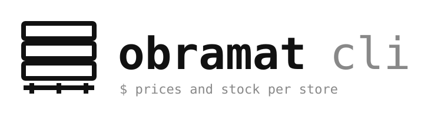
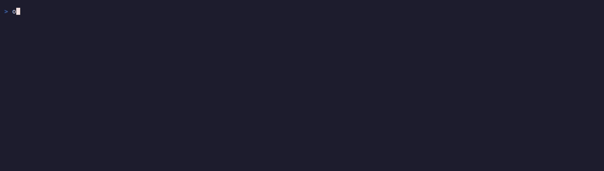

<p align="center">
  
</p>

<p align="center">
  <a href="https://github.com/n0nuser/obramat-cli/releases"></a>
  <a href="https://github.com/n0nuser/obramat-cli/actions/workflows/ci.yml"></a>
  <a href="https://pkg.go.dev/github.com/n0nuser/obramat-cli"></a>
  <a href="LICENSE"></a>
</p>

---

`obramat` is an unofficial terminal cli for obramat.es. it searches the catalogue with the same filters the site has, shows what a product costs at each warehouse and how many units each one holds, and watches products and searches for price and stock changes. it is read-only: no account, no cart, no orders. the site is behind bot protection, so it can replay your own browser session (cookies and user agent) over a chrome-like tls handshake. it compiles to one static Go binary. output is json by default so everything pipes into `jq`; `--format pretty` is for humans.

[documentation](https://n0nuser.github.io/obramat-cli/) | [command reference](https://n0nuser.github.io/obramat-cli/docs/reference/) | [github](https://github.com/n0nuser/obramat-cli)

<p align="center">
  
</p>

```console
$ obramat store stock 25064668 --lat 40.42 --lng -3.70 --format pretty
ID  STORE                STOCK  DISTANCE  SITE SAYS
12  Obramat Usera        94     10.7 km   94 en Stock
4   Obramat Leganés      205    13.0 km   205 en Stock
24  Obramat Alcobendas   68     17.1 km   68 en Stock
7   Obramat Rivas        86     19.4 km   86 en Stock
11  Obramat Majadahonda  266    22.2 km   266 en Stock
18  Obramat Alcorcón     198    22.4 km   198 en Stock
```

## for ai agents

two ways to wire `obramat` into an agent, both copy-paste:

```bash
# register the read commands as an MCP server (claude-code, codex or cursor)
obramat mcp install claude-code

# or read the embedded usage notes into the context
obramat skills get obramat-usage

# confirm the wiring with one live search
obramat search "cemento" --format pretty
```

the mcp server exposes `search`, `product_show`, `store_stock`, `store_list`, `store_near`, `category_list` and `watch_check`; each tool returns exactly what the matching command prints, json by default. `examples/` has more recipes.

## install

### one line

```sh
curl -fsSL https://raw.githubusercontent.com/n0nuser/obramat-cli/main/scripts/install.sh | sh
```

installs the latest release into `~/.local/bin` (`$PREFIX/bin` when `PREFIX` is set, or `$OBRAMAT_INSTALL_DIR`). the script picks the archive for your OS and architecture, verifies it against the release's `checksums.txt`, and only then installs it. pin a version with `VERSION`:

```sh
curl -fsSL https://raw.githubusercontent.com/n0nuser/obramat-cli/main/scripts/install.sh | VERSION=v1.2.3 sh
```

### go install

```bash
go install github.com/n0nuser/obramat-cli/cmd/obramat@latest
obramat --version
```

### npx

```bash
npx obramat-cli --version
npx obramat-cli search "tablero osb" --format pretty
```

the npm wrapper downloads the matching release binary during install. publishing runs from the `npm-publish.yml` workflow on a `v*` tag via npm Trusted Publishing (OIDC: no token stored anywhere, provenance automatic). one npm-side step remains: on npmjs.com, once the package exists, open it → Settings → Trusted Publishers → add a GitHub Actions publisher with owner `n0nuser`, repository `obramat-cli`, workflow `npm-publish.yml`, and an empty environment. until that exists the workflow fails, which is separate from the binary release.

### release binaries

download the archive for your platform from [releases](https://github.com/n0nuser/obramat-cli/releases) (linux, macos and windows, amd64 and arm64), unpack it and put `obramat` on your `PATH`. every release ships `checksums.txt` and a github provenance attestation; download both files first, then verify:

```bash
gh release download --repo n0nuser/obramat-cli --pattern 'obramat_*_linux_amd64.tar.gz' --pattern checksums.txt
sha256sum --ignore-missing -c checksums.txt
gh attestation verify checksums.txt --repo n0nuser/obramat-cli
```

### from source

```bash
git clone https://github.com/n0nuser/obramat-cli && cd obramat-cli
make build     # bin/obramat
```

homebrew, scoop and aur are written but commented out in `.goreleaser.yaml`; they stay disabled until the account side exists, because a block whose repository or secret is missing breaks the release. their exact prerequisites:

- **homebrew**: a `homebrew-tap` repository, plus a `HOMEBREW_TAP_GITHUB_TOKEN` secret with write access to it.
- **scoop**: a `scoop-bucket` repository, plus a `SCOOP_BUCKET_GITHUB_TOKEN` secret with write access to it.
- **aur**: an AUR account, plus an `AUR_SSH_PRIVATE_KEY` secret whose public key is registered on it.

## why

buying materials for a job means knowing which warehouse has forty boards of the right thickness before you drive there, and what they cost at that warehouse, because prices differ between stores. the site answers that one product and one store at a time, behind a store-picker drawer. this cli answers it for a product across every store at once, for a whole search at your store, and keeps answering on a timer so you hear when the boards are back. json output means scripts, agents and shell pipelines all read the same thing.

## quickstart

### check it works

```bash
obramat doctor --format pretty
```

`doctor` checks that the config parses, sinks are valid, a test search answers and parses, the default store resolves, the watch database opens, and whether the watch timer is installed.

### get through bot protection

obramat.es sits behind DataDome, which answers scripts with a challenge page. `obramat` gets through by replaying your own browser's session. the easy way is to let the cli read it out of the Chrome you already use:

```bash
obramat auth harvest            # copies the cookie store, opens Chrome, harvests
```

the trusted datadome cookie lives in your everyday profile, so the cli copies just that profile's cookie store and key reference into a temp profile (0700, deleted when the command ends) and opens Chrome on it. it opens headed so you can clear any check it shows; the cli waits (up to `--timeout`, 5 minutes by default) and reads the session out over the devtools protocol. `--profile`/`OBRAMAT_CHROME_PROFILE` names the profile (default: the usual Chrome and Chromium locations, first one with cookies); `--chrome`/`OBRAMAT_CHROME` names the binary. this is a copy rather than an attach because Chrome 136+ ignores `--remote-debugging-port` on the default profile; `--browser-url` (or `OBRAMAT_CHROME_URL`, or a Chrome already on `http://localhost:9222`) attaches when you have one running with the port. with no real profile found, a fresh window opens instead and may need a captcha.

or import an export by hand:

```bash
obramat auth login --cookies ~/Downloads/obramat-cookies.json
obramat auth status --check
```

either way the session is stored 0600 and no password is ever asked for; a guest session with a store selected is enough. when the site stops trusting it, harvest again or reload the site in the same browser and import. `OBRAMAT_COOKIEJAR=FILE` uses an export without storing it (for CI). `obramat auth logout` forgets the stored session.

stuck? [troubleshooting](docs/troubleshooting.md) starts with `obramat doctor` and `obramat auth status --check`.

### pick your store

prices and stock belong to a store. find yours and make it the default:

```bash
obramat store near --lat 40.42 --lng -3.70 --format pretty
obramat store list --format pretty
obramat config set store 4
```

or pass `--store` per command (code, slug or name: `--store 4`, `--store leganes`), or set `OBRAMAT_STORE`. without a store the site shows a default web price (some products then show a canary islands IGIC price) and no stock.

## updates

```bash
obramat update --check
obramat update --yes
```

interactive commands check for a new release at most once a day and ask before updating. scripts, `mcp`, `watch` and `--no-input` never check. `OBRAMAT_NO_UPDATE_CHECK=1` turns it off. the download is verified against the release's `checksums.txt` before it replaces the binary. builds from source are not replaced.

## command surface

| command | what it does |
|---|---|
| `search [keywords] / search filters` | search or browse a category with brand, price range, sort and any facet; `filters` lists the facets |
| `product show` | price, stock at your store, delivery options, ean and characteristics |
| `category list` | category paths for `search --category` |
| `store list / near / show` | warehouses with their codes, the nearest ones, opening state |
| `store stock PRODUCT` | stock at one store, at the six nearest a point, or at all of them |
| `watch add search\|product` | watch a search or a product at a store |
| `watch check / run / events / list / remove` | one-shot check, foreground loop, history |
| `watch service install / uninstall / status` | systemd user timer or launchd agent running `watch check` |
| `sink list / test` | notification targets from config |
| `auth harvest / login / status / logout` | read, import, inspect or forget the browser session the site's bot protection needs |
| `mcp / mcp install` | serve the read commands to an agent harness |
| `config path / list / get / set` | config.toml |
| `doctor` | checks config, sinks, the site, the store, the watch state |
| `skills list / get` | embedded usage notes for agents |
| `update` | replace the binary with the latest release |
| `completion bash\|zsh\|fish\|powershell` | shell completion |

global flags: `--format json|jsonl|pretty|toon`, `--no-color`, `--error-format text|json`, `--no-input`, `--debug`.

## examples

```bash
obramat auth login --cookies ~/Downloads/obramat-cookies.json

obramat search "tablero osb" --format pretty
obramat search cemento --brand WEBER --min-price 5 --max-price 20 --sort price_asc --store 4
obramat search "tablero osb" --store leganes --in-stock --format pretty
obramat search --category /madera/tableros/tableros-y-tablas-de-madera/ --filter attribute-00596=15
obramat search filters cemento --format pretty
obramat product show 25064668 --store 4 --format pretty
obramat store stock 25064668 --all --format pretty

obramat search "tablero osb" --store 4 | jq -r '.products[] | "\(.stock.quantity)\t\(.price.amount)\t\(.title)"'
obramat store stock 25064668 --all | jq '[.stores[] | select(.stock.quantity >= 40) | .store.name]'
```

## watches

a watch saves a search or a product, pinned to a store, and each check reports what changed: `product.new`, `product.price_changed`, `product.stock_changed`, `product.out_of_stock`, `product.back_in_stock`, `product.removed`.

```bash
obramat watch add product 25064668 --store leganes --name osb-15 --notify phone
obramat watch add search "tablero osb" --store 4 --max-price 30 --name osb
obramat watch check --format jsonl | jq -r 'select(.type=="product.back_in_stock") | .product.url'
obramat watch service install --interval 1h
```

## sinks config

```toml
[sinks.phone]
type = "ntfy"
url = "https://ntfy.sh"
topic = "my-obramat-alerts"

[sinks.chat]
type = "webhook"
url = "https://discord.com/api/webhooks/..."
template = "discord"

[sinks.script]
type = "exec"
command = ["~/bin/on-obramat-event"]   # event json on stdin
```

## exit codes

`0` ok, `1` generic, `2` usage, `3` `auth status --check` with no browser session, `4` not found, `5` blocked by the site's bot protection or rate limited (the cli then stays away from the site for 10 minutes), `6` network or site down, `7` the site changed shape (stderr carries a prefilled issue link), `130` interrupted.

## development

after `make build` (see [install](#install)):

```bash
make check     # vet, staticcheck, tests, gofmt
```

### live smoke test

`go test` never touches the network. once you have a browser session (`obramat auth harvest`), one guarded smoke test checks the real site:

```bash
OBRAMAT_LIVE_TEST=1 go test ./internal/api -run TestLiveSearch -v
```

it skips without `OBRAMAT_LIVE_TEST=1`, and skips with a message when no stored session exists.

## documentation

the docs site source is in `docs-site` (fumadocs, exported as static pages); its command reference is generated from the binary with `make docs`.

- [docs/cli-spec.md](docs/cli-spec.md): the interface contract
- [docs/obramat-api-discovery.md](docs/obramat-api-discovery.md): how the site works, endpoint by endpoint
- [docs/troubleshooting.md](docs/troubleshooting.md): the common failures, starting with `doctor`
- [examples/](examples/): ready-to-run search, stock, watch and doctor recipes
- [AGENTS.md](AGENTS.md): vocabulary and working rules
- [docs/adr](docs/adr): decisions

## contributing

issues and pull requests are welcome. when the site changes, the cli exits `7` and prints a prefilled issue link; that is the most useful report you can file.

## disclaimer

this is an unofficial client, not affiliated with, endorsed by or connected to obramat or its parent company. "obramat" is a trademark of its owner and is used here only to say which site the tool works with. the site publishes no api; the cli reads the same public pages a browser does, for interoperability. it is read-only and asks for no password: the optional session it replays is your own browser's, stored locally at 0600 on your machine. use it responsibly and keep the request rate low: no bulk scraping, keep watch intervals reasonable. prices and stock shown are what the site showed at that moment; check the site before you buy.

## license

[mit license](LICENSE)
